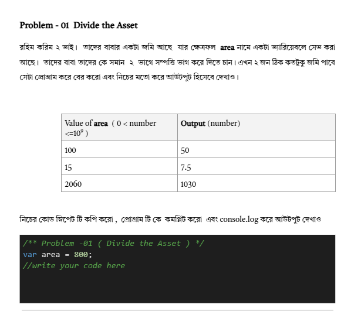
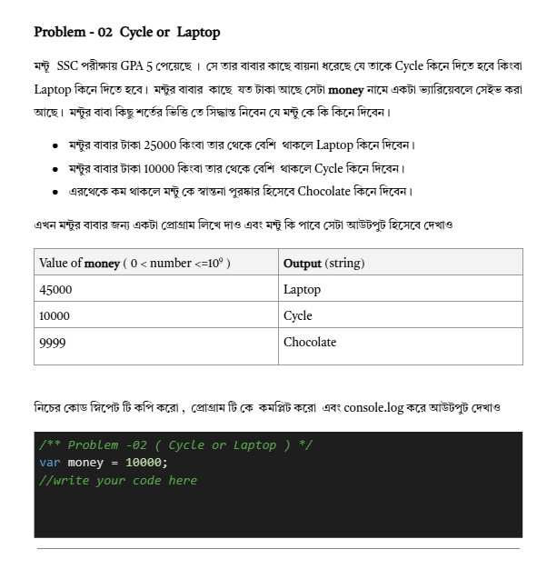
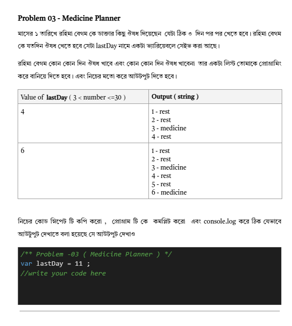
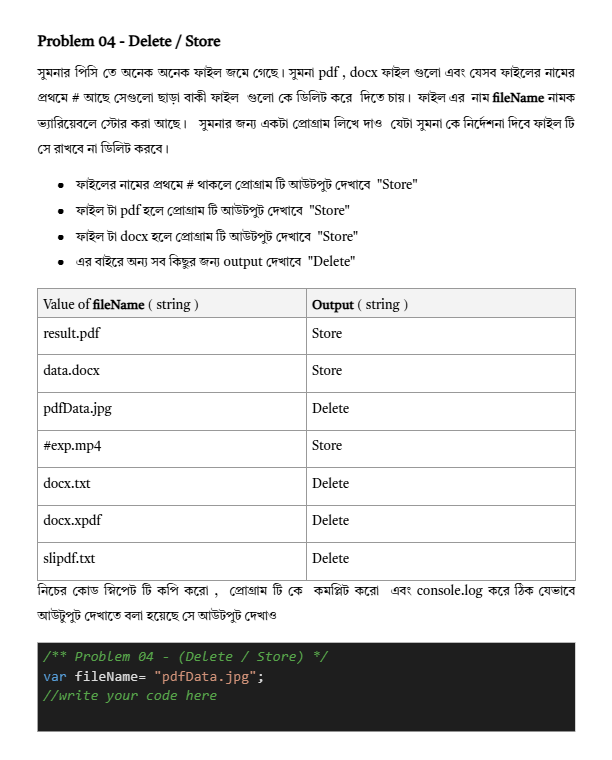
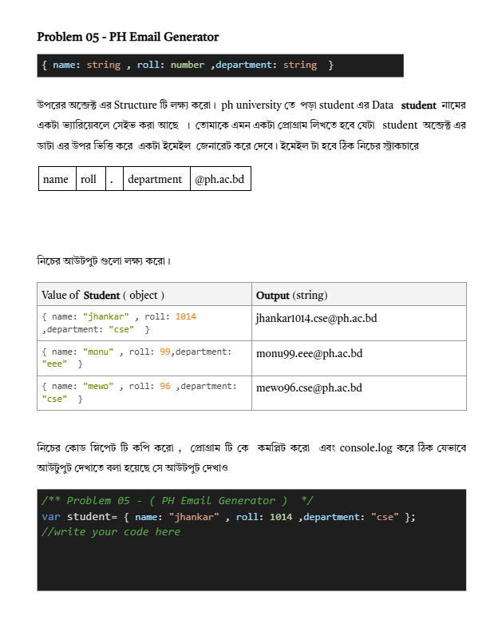
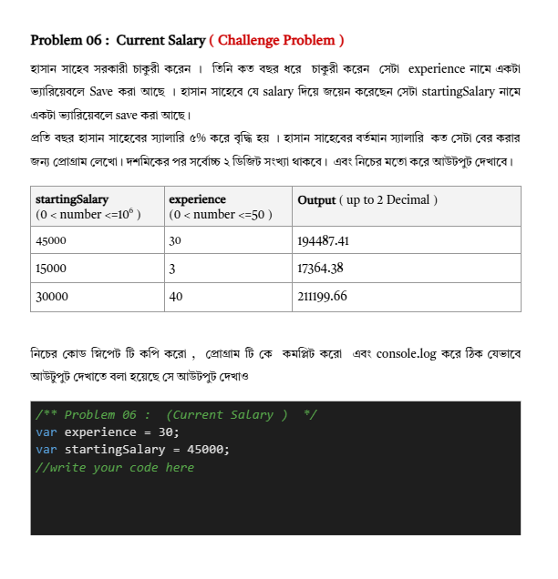

Assignment - 03
Important Note:
প্রতি টা প্রবলেম ভালো ভাবে পড়বে , লজিক খোজার চেষ্টা করবে, এবং এরপর কোড করে প্রবলেম টি সল্ভ করবে। 
প্রতি টা প্রবলেম এ ই দেখবে যে specific ভাবে কিছু জিনিস console.log করতে বলা হয়ছে।। এর বাইরে নিজের মনের মতো করে কিছু  console করবেনা ।  যদি এমন  টা  করো তাহলে কোড ঠিক থাকলে ও তুমি মার্ক পাবেনা।
প্রতি টা প্রবলেম এ  যে  ভ্যারিয়েবল গুলোর নাম  গুলো আছে সেটা কোন ভাবে ই চেঞ্জ করা যাবেনা। 
সব গুলো ভ্যারিয়েবল কে var দিয়ে ডিক্লেয়ার করবে।  চেষ্টা করবে ১ টা প্রবলেমের ভ্যারিয়েবল যাতে অন্য প্রবলেমের ভ্যারিয়েবলের সাথে মিলে না যায়।  
কোন কিছু না বুঝলে সাপোর্ট সেশনে জয়েন করবে। গ্রুপে পোস্ট করবে।   এসাইনমেন্ট রিলেটেড সরাসরি কোন হেল্প নেয়া যাবেনা।  নিজের লজিক নিজে বানাবে।  সাপোর্ট থেকে সর্বোচ্চ এসাইনমেন্ট এর প্রবলেম টা বুঝে নিতে পারবে। 
প্রশ্ন ভালো করে পড়বে।  চ্যাটজিপিটি থেকে শুরু করে অন্য যেকোন এ আই টুল অথবা বন্ধুর হেল্প নেয়া যাবেনা।  তুমি যদি এই কাজ টি করো এর মানে হলো নিজের পায়ে নিজে কুড়াল মারছো।  আর আমাদের এ আই  এক্সটেনশন যদি তোমার ফাংশন কে  AI Generated হিসেবে ডিটেক্ট করে,  তাহলে তুমি এসাইনমেন্ট এ জিরো পাবে। 
What to Submit :
সবগুলো কোড কে ক্রমানুযায়ী একটা ফাইলে নিয়ে এসে পুরো কোড টা কপি  করো। এবং Assignment Submission box এ পেস্ট করে সাবমিট করে দাও ।  
Deadline : 
60 Marks Deadline:		 Till 04 August 11.59 PM
50 Marks Deadline : 	Till 06 August 11.59 PM  (Extended  For Our July Heroes) 
30 Marks Deadline : 	Anytime after 05 August

