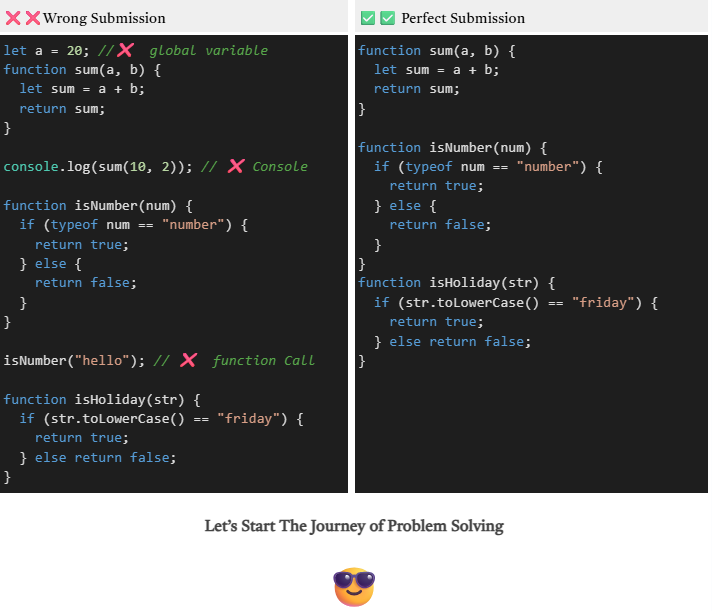
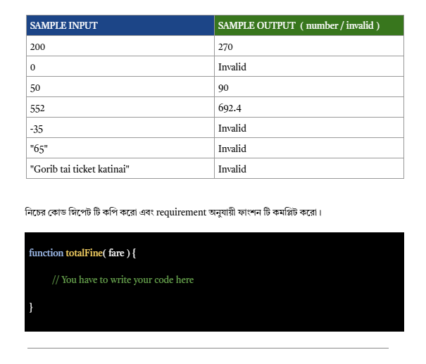

Important Note:
তোমাকে কোডের সব  লজিক এবং ভ্যারিয়েবল  গুলো ফাংশনের ভেতরে লিখতে হবে। কোন ভ্যরিয়েবল তুমি ফাংশনের বাইরে অর্থাৎ গ্লোবালি ডিক্লেয়ার করবেনা। 
ফাংশনের বাইরে যদি কোড লিখে থাকো যেমন ধরো ফাংশন কে কল করা বা কনসোল করা সেগুলো সাবমিট করার আগে অবশ্যই ডিলেট করে দিতে হবে বা কমেন্ট করে দিতে হবে। 
প্রশ্নে যে ফাংশনের নাম দেয়া হয়েছে সেটা ই ব্যবহার করতে হবে। অন্য নাম ব্যবহার করা যাবেনা।   
প্রতি টা প্রবলেম ভালো ভাবে পড়বে , লজিক খোজার চেষ্টা করবে, এবং এরপর কোড করে প্রবলেম টি সল্ভ করবে। 
চ্যালেঞ্জ অংশে যে শুধুমাত্র যে  অংশ টুকুর জন্য ভ্যালিডেশন করতে বলা হয়েছে শুধু মাত্র তত টুকু ইমপ্লিমেন্ট করলে ই হবে।   তার থেকে বেশী করার প্রয়োজন নেই। 
প্রতি টা প্রবলেম এ ই দেখবে যে ফাংশন থেকে কিছু return করতে হবে। function থেকে specific যা রিটার্ন করতে বলা হয়েছে তা ই রিটার্ন করবে। এর বাইরে নিজের মনের মতো করে কিছু রিটার্ন করবেনা।  console ও করবেনা ।  যদি এমন  টা  করো তাহলে কোড ঠিক থাকলে ও তুমি মার্ক পাবেনা।
প্রশ্ন ভালো করে পড়বে।  চ্যাটজিপিটি থেকে শুরু করে অন্য যেকোন এ আই টুল অথবা বন্ধুর হেল্প নেয়া যাবেনা।  তুমি যদি এই কাজ টি করো এর মানে হলো নিজের পায়ে নিজে কুড়াল মারছো।  আর আমাদের এ আই  এক্সটেনশন যদি তোমার ফাংশন কে   AI Generated হিসেবে ডিটেক্ট করে,  তাহলে তুমি এসাইনমেন্ট এ জিরো পাবে।
Deadlineঃ
60 Marks Deadline Till 15 August 11.59 PM
50 Marks Deadline Till 17 August 11.59 PM
30 Marks Deadline - Any Time after 17 August 11.59 PM

What to Submit: শুধু মাত্র function গুলো কে  কপি করে সাবমিট করে দিতে হবে। 
সবগুলো  function কে কপি করে একটি আলাদা ফাইলে নিয়ে যান। 
 যত console.log করা লাইন আছে।  সব গুলো কে কেটে দিন / কমেন্ট করে দিন। 
এবার পুরো ফাইল টি কে কপি করে submission box এ পেস্ট করুন।
নিচের এক্সাম্পল টি দেখুন।   

Problem-01 : Train TT's Fine Calculator 
⚠️ Function Name Must be totalFine()
ট্রেনের একজন TT হিসেবে কাজ করছেন রবিন। প্রতিদিন অসংখ্য যাত্রী টিকিট হারিয়ে ফেলেন কিংবা কাটেন ই না। টিকিটবিহীন যাত্রীদের জরিমানা করতে গিয়ে প্রতিবার ক্যালকুলেশন করতে অনেক সময় লাগে। তাই TT রবিনই জরিমানার নির্ভুল হিসাব চলে আসবে চায়, এমন একটি ফাংশন যেখানে যাত্রীর ট্রেন ভাড়া দিলে। 
তুমি যেহেতু প্রোগ্রামার , তাই তোমাকে রবিন সাহেবের জন্য  totalFine নামে একটা function তৈরী করে দিতে হবে।  যেটা fare কে ইনপুট হিসেবে নেবে।  এবং fine ক্যালকুলেট করে return করবে।   
🧮 জরিমানা নির্ধারণের নিয়ম:
মোট জরিমানা = টিকিটের মূল ভাড়া + (২০% সারচার্জ) + অতিরিক্ত ৩০ টাকা সার্ভিস চার্জ
📥 Input:
ফাংশনটি  একটি পজিটিভ সংখ্যা (number) ইনপুট নেবে  

🚀 Output:
Input এর  ওপর ভিত্তি করে ফাংশনটি মোট  জরিমানা হিসাব করে একটি সংখ্যা return করবে
Output দশমিক সংখ্যা হতে পারে। 
Note: তোমাকে অবশ্যই output টা রিটার্ন করতে হবে।  console.log করলে কোন মার্ক পাবেনা

🚩Challenge:  
যদি ইনপুট টি number না হয়  অথবা  পজিটিভ সংখ্যা না হয়  তাহলে  "Invalid"  স্ট্রিং  রিটার্ন করবে। 

💡Hints:  যদি ইনপুট 200  হয়, তাহলে fine হবে: 200 + 200 × ( 20 / 100) + 30 = 270 Taka

